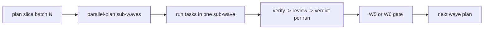

# ai-task delivery waves playbook

This is the short operator guide for delivery waves. It is the practical companion to `skills/ai-task-teamlead/SKILL.md` and `docs/ai-task.md`.

Use this when you need a fast reminder of how to run one wave safely.

## Mental model

The steps W0 to W6 named in this guide are the wave steps of the table in
`skills/ai-task-teamlead/SKILL.md`.

One wave is not one command. One wave is a sequence:

1. **Plan a batch** (`plan --batch N` or `plan --auto-batch`).
2. **Split into sub-waves** with `parallel-plan` (only when batch size is 2+).
3. **Run tasks in each sub-wave concurrently** (within `max_concurrent`).
4. For each run, finish **verify -> review -> verdict -> release** (see below).
5. Do wave gate checks (W5/W6): status, wave summary, backlog updates (decision reflect/grading runs once at engagement-end retro).
6. Start the next wave with a fresh plan.



## Command cheat sheet

Use these as operator primitives:

```bash
# Pick a wave size from policy (capped by max_size)
ai-task plan --auto-batch

# Build sub-waves from the current batch (same N logic)
ai-task parallel-plan --auto-batch --json

# Record why you accepted or overrode the parallel strategy
ai-task decision log --phase parallel --choice parallel_waves --reason "..."
```

Safe multi-run dispatch:

- Run one task id per shell/process.
- Do not start the same task id twice (leases are a guard, not a strategy).
- Keep concurrency at or below `parallel.max_concurrent`.
- Close each run through verify, review, and verdict before wave close.

## Collision-aware sub-wave packing

`parallel-plan` no longer over-serializes a batch just because tasks have no
explicit path lists. It predicts which files each task will touch, builds a
conflict graph, and packs **maximal disjoint waves** up to
`parallel.max_concurrent` (a pattern seen in practice: one hot-file task
plus independent fillers per wave, instead of serial singletons).

How predictions feed the plan:

1. **Predicted file set per task** (`signals[task_id].predicted_files`,
   sources in `signals[task_id].file_prediction`):
   - explicit path tokens in the task text (`src/ui/Minimap.tsx`); bare file
     names (`Minimap.tsx`) expand to the tracked path via `git ls-files`;
   - CamelCase component hints in prose (`CommandCard`, `RoleCrossCut`) mapped
     to tracked files with that name, or kept as abstract `component:<name>`
     markers when the repo has no matching file yet;
   - files changed by recent commits (`git log -200 --name-only`) whose
     subjects mention the same components — "git history of similar tasks".
   A task whose only scope evidence is a prose component mention is no longer
   treated as broad scope once predictions found concrete targets.
2. **Conflict graph** (`collision_edges`): one edge per pair that must not
   share a wave, each with the reason it was separated — shared predicted
   files, a bare-name/path match, a directory claim, unknown scope (no
   predictions on either side stays conservative), broad scope, P0 in pair, or
   an in-batch dependency. Same-directory tasks with **distinct** predicted
   files no longer collide.
3. **Packing**: each wave is the largest set of dependency-ready tasks with no
   collision edge between any pair, capped at `max_concurrent` (exact search up
   to 16 candidates, greedy beyond). In-batch dependencies still force later
   waves. `reasoning` reports the packed widths (for example
   `wave packing: widths 3/3/3/1 under max_concurrent 3`).

When the teamlead should still override (`decision log --phase parallel
--choice override_parallel_plan`):

- Predictions are **heuristics from task text and history**, not a file lock.
  If you know two "disjoint" tasks meet in a file the text never names (a
  shared route table, barrel `index.ts`, generated artifact, lockfile), split
  them into separate waves yourself.
- Stale history: after a large refactor or rename, `git log` predictions can
  point at files that moved; trust the current tree over the edges.
- Missing hints: a task with empty `predicted_files` collides with everything
  by design. Either accept the serial wave or improve the task text with real
  paths (preferred — the fix belongs in the backlog, not in a repeated manual
  override).
- Cross-file coupling without file overlap (shared API contract, schema,
  i18n keys) is invisible to file-level prediction; keep such pairs
  sequential even when the plan packs them together.

W3 quota-aware dispatch and quota auto-resume:

```bash
# Preflight before a Claude sub-wave (headless dispatch auto-refreshes a stale snapshot)
ai-task quota status --json

# Long headless waves: wait through waiting_quota, probe Claude, re-launch the same packet
ai-task wait-runs <run-id>... --resume-on-quota
```

- Operator rules — normative: `skills/ai-task-teamlead/reference-operations.md` → W3 quota-aware dispatch (quota-source preflight, sizing the sub-wave to reservations, «a quota-blocked Claude task is not failed work», wait / fallback / smaller sub-wave reporting, `waiting_quota` handling).
- Mechanism — normative: `docs/ai-task.md` → Claude quota reserve (admission control and reservations, `quota_blocked` vs `waiting_quota`, retry budget, resume receipts, limit-pattern cooldowns).

W3 risk confirmation shortcut:

- Before dispatch, compare W1 `plan --json` `review_gates` with the task packet/backlog block.
- If a task has `high-priority:P0` or `high-priority:P1` and Task Context contains `Risk: P0, approved` or `Risk: P1, approved`, the confirmed delivery scenario is enough approval. Add `--confirm-risk` without asking again.
- Log the shortcut as `ai-task decision log --phase delivery --choice auto_confirm_risk` with the task id and matching backlog signal.
- If the high-priority gate exists but the task has no `Risk: P[01], approved` line, ask the user once before dispatching with `--confirm-risk`.

Detached run monitoring:

- Save the run ids printed by `ai-task run TASK-ID`.
- Wait while any target run is still `running`, `paused`, or (in resume mode) `waiting_quota`; stop waiting only when all target run ids are inactive.
- Preferred helper: `ai-task wait-runs <run-id>...`; add `--json` for scripts and `--timeout` for bounded waits.
- **For long unattended waves, add `--resume-on-quota`** so the helper waits through `waiting_quota`, sleeps until reset, probes, and re-launches the same packet. Without it, a `waiting_quota` run is reported as inactive (nothing drives it to completion in that call).
- Fallback only when `wait-runs` is unavailable: use a `while active; sleep; done` status loop whose predicate returns success while at least one target run is active.
- Avoid `until` loops whose predicate returns success while runs are active. `until` exits as soon as the predicate succeeds, so it can end immediately on a healthy live sub-wave.

In-session runs have no process, so `wait-runs` does not apply to them. The teamlead waits for its own subagent's answer and records it with `ai-task worker-done <run-id>`; see `skills/ai-task-teamlead/reference-operations.md`, In-session executor.

Worktree merge cadence (ai-task runs with `worktrees_enabled`, especially `isolated_worktree_batch`):

- **Before dispatch, run the W2 overlap gate** — normative: `skills/ai-task-teamlead/reference.md` → Overlap gate before parallel+worktrees (threshold, trade-off message, when to ask the user).
- Merge cadence decision rule (immediate vs deferred, switch rule, dependency order) — normative: `docs/ai-task.md` → Worktree overlap and apply cadence. If overlap is discovered mid-batch, run `scripts/worktree-preflight.py` and switch to immediate merge for remaining runs.
- Parallelism-ROI reflection at engagement-end retro calibrates the overlap threshold — normative: `skills/ai-task-teamlead/reference-journal.md` (`phase=parallel` reflection).

IDE **sdlc-implement-all** uses the main tree only (no per-task worktrees). See `skills/sdlc-implement-all/SKILL.md`.

## Release per task (W4)

Normative contract (who commits, who marks `[x]` and writes the Progress line): `skills/ai-task-teamlead/reference-review-gates.md` → Run release contract.

Checks:

```bash
ai-task status --json
ai-task complete <run-id>                   # reminds about a missing [x] or Progress line
ai-task complete <run-id> --require-report  # only when the task's DoD asks for tasks/<ID>.md
```

For React/UI tasks and changes gated on cross-origin resources, network-status visibility, or browser-only interactions, apply the **UI-interaction review template** and the **real-browser evidence gate** — normative: `skills/ai-task-teamlead/reference-review-gates.md`.

When `--wait` is the right choice:

- Sequential wave (one task at a time).
- Single task execution.
- Debugging one unstable run and watching fallback behavior.

When `--wait` is usually not the right default:

- Parallel sub-wave execution where multiple runs should progress together.

## Policy knobs that shape wave behavior

| Knob | Meaning |
|------|---------|
| `batch.default_size` | Default planned wave size when user does not specify one |
| `batch.max_size` | Hard cap for planned wave size |
| `batch.auto_target` | Target size used by `--auto-batch` |
| `parallel.max_concurrent` | Max runs at once inside one sub-wave |
| `worktrees_enabled` | Run each task in isolated git worktree when true |

Glossary:

- **Wave batch size** = how many task ids `plan` selects for this wave.
- **`max_concurrent`** = how many runs can execute at the same time.
- They are different controls. Batch size does not force equal concurrency.

## Product slice vs delivery wave

Product can hand off a "next slice" (usually 1-3 ids) during discovery. That slice is a planning hint, not a delivery limit.

Delivery still uses fresh wave planning, and `plan --auto-batch` may choose up to `auto_target` (commonly 5) when dependencies and policy allow it.

## What the CLI does not do

`ai-task` does not auto-run a whole wave after planning. There is no `run-wave` command.

Teamlead dispatches each run, then closes each run with verify, review, and verdict before moving on.

## Monolithic UX note

Operators can run without user pauses between waves, but delivery still follows wave gates and product handoff rules.

Even in "no pause" mode, product ownership of backlog updates remains required (see the product and teamlead skills).

## Related docs

- Main reference: `docs/ai-task.md`
- Backlog contract: `docs/ai-task-backlog-contract.md`
- Teamlead operational skill: `skills/ai-task-teamlead/SKILL.md`
- Maintainer scope and CLI ownership: `skills/ai-task-maintainer/SKILL.md`
