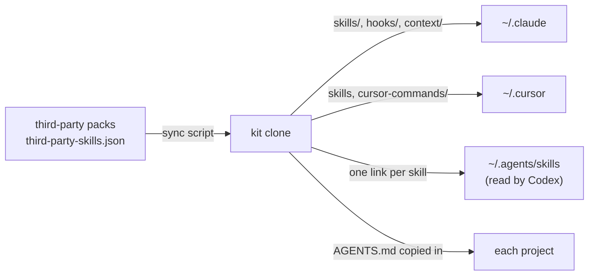
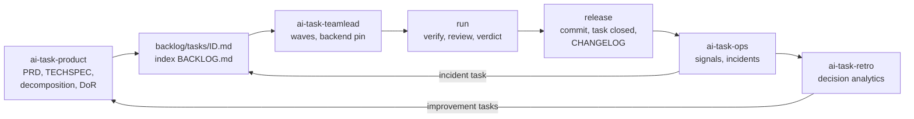
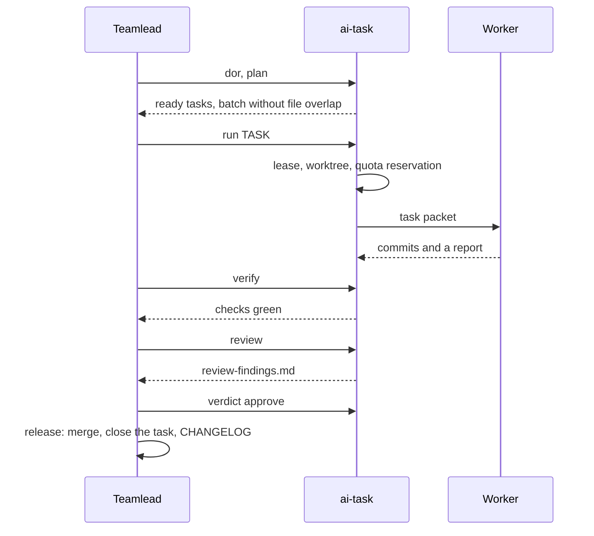

# Overview

This kit turns one developer and a few LLM coding agents (Claude Code, Codex,
Cursor) into a delivery process you can repeat: roles with clear boundaries, a
backlog kept in git with one file per task, machine gates before and after each
change, quota control, and a feedback loop where the decisions of one batch feed
improvement tasks for the next. The goal is to deliver a batch of tasks without
watching every step. A person is needed only at the escalation points the rules
name.

The rest of this page shows how the parts fit. Each section links to the
reference doc that owns the details.

## Words used below

- **DoR** (Definition of Ready): a task is described well enough to start;
  `ai-task dor` checks it.
- **Run**: one attempt to deliver one task, recorded under `.ai-task/` of the
  repository. **Worktree**: a separate git working copy for one run. **Lease**: a
  mark that one run has taken the task. **Task packet**: the task text and the
  rules a worker gets instead of the whole backlog.
- **Verify** runs deterministic checks (lint, tests), **review** looks for bugs
  in the diff, and the **verdict** is the teamlead's decision on a run: approve,
  rework, split, defer or escalate.
- **Wave**: one pass over a batch of tasks, from the DoR check to the release.
- **Headless worker**: an agent CLI started as its own process (`claude -p`,
  `codex exec`), without an interactive session.

## One clone, every project

You clone the kit once and link it into the profile folders of your agents.
A skill edited in the clone works from the next session in every project, with
no install step.

[SETUP.md](../SETUP.md) gives the link steps. A project gets the shared rules
file `AGENTS.md` (see [SETUP_NEW_PROJECT.md](../SETUP_NEW_PROJECT.md)), and an
optional `AGENTS.override.md` next to it holds the rules of that project only.

## Skills by group

The name of a skill opens with its group:

| Prefix | What the skills do |
|--------|--------------------|
| `sdlc-` | the local delivery cycle without the CLI: PRD and TECHSPEC interviews, backlog decomposition and upkeep, one task or all tasks end to end, DoD check, docs update, spec sync |
| `ai-task-` | the roles that drive the `ai-task` CLI: product, teamlead, reviewer, retro, ops, maintainer, init |
| `dev-` | development helpers: Python UI choice, PySide, app icons, GitHub link buttons, refactoring from a code snapshot, a security audit |

Two skills keep plain names: `close-chat` checks that a session left nothing
behind, and `commit-current-changes` makes one commit on request. Third-party
skills keep the names of their upstream packs, see
[external-skills.md](external-skills.md). How to write a skill of your own:
[skill-authoring.md](skill-authoring.md).

## The delivery cycle

The same discipline holds without the CLI: the `sdlc-` skills take a task from
`BACKLOG.md` through implementation, checks and docs in one session.

| Role (skill) | Owns | Why it is separate |
|--------------|------|--------------------|
| `ai-task-product` | PRD and TECHSPEC interviews, decomposition, DoR, priorities, backlog metadata | product questions get settled before delivery starts, and the teamlead does not edit another role's metadata |
| `ai-task-teamlead` | delivery waves: plan, dispatch, verify, review, verdict, release; picks the worker and pins it for the wave | delivery has its own quotas, worktrees and gates, and a hard DoR block at the entry |
| `ai-task-reviewer` | three review passes chosen by the stack, `review-findings.md`, handing back the verdict | bug finding in a fresh context, apart from the author |
| `ai-task-retro` | a decision retrospective after a batch: analytics, lessons, improvement tasks | the feedback loop needs an owner, or lessons stay in logs |
| `ai-task-ops` | a live service after release: signals, incident triage, an incident becomes a backlog task with its source | production experience comes back into the backlog with a priority |
| `ai-task-maintainer` | the CLI code and its default policy | changing the tool is a different job from delivering tasks with it |

The operator guide [ai-task-teamlead-sdlc.md](ai-task-teamlead-sdlc.md) walks
through a wave step by step, and [ai-task-delivery-waves.md](ai-task-delivery-waves.md)
describes how waves are planned.

## One run of the CLI

`ai-task` is a Python CLI built on the standard library only. A repository opts
in with `ai-task init`; a repository without `.ai-task/` keeps using the skills
and the backlog without it.

A worker runs in one of two modes, and the teamlead always names which:

- **headless**: the CLI starts `claude -p`, `codex exec`, Cursor or Devin as its
  own process inside the worktree, with a sandbox and a write boundary;
- **in session**: a fresh subagent of the teamlead session does the work, and
  `ai-task worker-done` records its answer; the CLI still takes the lease, makes
  the worktree and reserves quota.

Claude Code and Codex are equal here: each can be the teamlead or the worker.
When neither the project nor the owner picks a worker, the CLI takes one from
the same vendor as the teamlead. Full reference: [ai-task.md](ai-task.md).

## Mechanisms and what each is for

| Mechanism | What it does | Why |
|-----------|--------------|-----|
| Backlog contract and DoR | one file per task with `Priority`, `Size`, `Depends on`, `Agent`, `Verify`; a generated index; `ai-task dor` blocks a task that is not ready ([ai-task-backlog-contract.md](ai-task-backlog-contract.md)) | a worker gets only its task, a vague task fails before it burns quota, and parallel sessions never edit one file |
| Backend pin | `ai-task pin <backend>` keeps one worker vendor for the whole wave; neither a limit nor quota switches vendor silently | vendors charge and code differently, so a switch is a decision, not a fallback |
| Quota supervision | a snapshot of the 5-hour and 7-day windows, a reserve stop line, reservations by `Size:`, admission control, `waiting_quota` with resume | a headless wave neither burns the window to zero nor dies on a limit: a quota block means waiting, not failure |
| Verify gates | command profiles (`ruff`, `pytest`, `npm run lint` and others); review is refused until verify is green ([ai-task-verify.md](ai-task-verify.md)) | deterministic checks come before an AI review |
| Review registry | maps a stack to the review skills and reports `ok`, `partial` or `none-detected` ([ai-task-review-registry.md](ai-task-review-registry.md)) | review depth follows the stack, and the registry checks that the named skill is installed |
| Explicit verdicts | approve, rework, split, defer or escalate, each with its next command | no run ends without a decision and an owner |
| Worktrees and batch planning | parallel tasks run in separate working copies, and the planner packs a batch so tasks do not touch the same files | two tasks in the same files without isolation give a broken merge, and the planner sees that before the start |
| Decision journal | `.ai-task/decisions.jsonl`, anomaly stubs, `decision analytics` with targets and recurrence ([ai-task-decisions.md](ai-task-decisions.md)) | the teamlead's decisions become measurable, and the retro works from data |
| One owner per rule | each rule has one normative copy, and other files link to it ([ai-task.md](ai-task.md)) | a rule copied into several files drifts |

## Trust and safety

Task text is input that the agents execute, so a task block can carry a prompt
injection, and a third-party skill is code from someone else.
[threat-model.md](threat-model.md) lists the actors, the trust boundaries of each
worker and the controls. [vendor-contract.md](vendor-contract.md) lists the
behaviors of Claude Code, Codex, Cursor and Devin that the CLI relies on, and how
each one is checked.

## Slides

`ai-sdlc-overview.build.js` in this folder is a short deck about the approach,
in Russian, with no ties to a particular project. `scripts/build-decks.sh`
builds it into a `.pptx` and a `.pdf`; it needs Node.js and LibreOffice.
